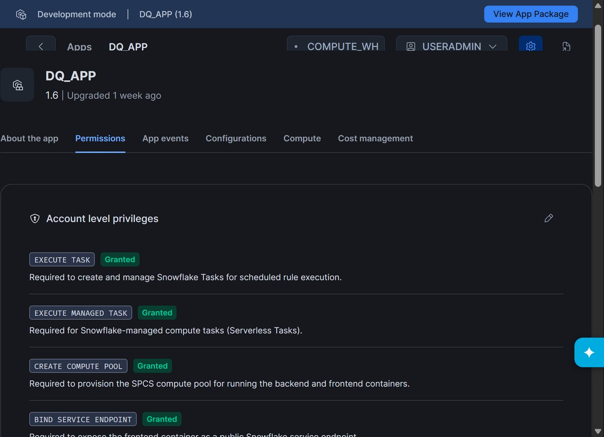

# Step 1: Installation & Table Access Grants

This step covers getting started with **Artha DataTrust** from the Snowflake Marketplace and granting table access through the Snowsight user interface.

---

## 1. Install Artha DataTrust from Marketplace

1. Navigate to **Snowflake Marketplace** in the Snowsight navigation sidebar.
2. Search for **Artha DataTrust** and click **Get**.
3. Select your desired Snowflake warehouse (e.g., `DQ_WH` or a general purpose compute warehouse) and click **Get**.

Once installed, Artha DataTrust appears under **Data Products** -> **Apps** in Snowsight.

---

## 2. Navigate to App Permissions & Required Grants

Before Artha DataTrust can operate, provision compute, and scan your data, review and grant the required permissions in the Snowsight UI:

1. In Snowsight, open **Data Products** > **Apps** and select **Artha DataTrust**.
2. Click the **Permissions** tab at the top of the app details page.

### Required Permissions Summary:
- **Account Level Privileges**:
  - `EXECUTE TASK`: Required to create and manage Snowflake Tasks for scheduled rule execution.
  - `EXECUTE MANAGED TASK`: Required for Snowflake-managed compute tasks (Serverless Tasks).
  - `CREATE COMPUTE POOL`: Required to provision the SPCS compute pool for running backend and frontend containers.
  - `BIND SERVICE ENDPOINT`: Required to expose the frontend container as a public Snowflake service endpoint.
  - `CREATE WAREHOUSE`: Required to create a dedicated XS warehouse (`DQ_WH`) for the backend service to execute queries.
  - `IMPORTED PRIVILEGES ON SNOWFLAKE DB`: Required to query account telemetry and credit attribution history.
- **Database Roles for SNOWFLAKE Database**:
  - `SNOWFLAKE.CORTEX_USER`: Required to call Snowflake Cortex AI functions for AI Assistant, rule suggestions, and anomaly insights.
- **Object Access Privileges (Table to scan)**:
  - Grants `SELECT` on consumer tables via the UI Object Picker.

---

## 3. Grant Table or Schema Access

You can grant access either directly via the UI or by granting Database/Schema USAGE:

### Option A: Snowsight Object Picker (Table to scan)
1. Click **+ Add** (or **Review**) next to **Table to scan** (`CONSUMER_TABLE_REF`).
2. Use the database hierarchy tree to browse your database and schema (e.g. `SNOWFLAKE_SAMPLE_DATA.TPCH_SF1.CUSTOMER` or your own test database `DQ_TEST_DB.TEST_DATA`).
3. Click **Done** and then click **Grant**.

### Option B: Schema / Database USAGE Grants
To monitor entire schemas or databases, run:
```sql
-- 1. Grant USAGE on Database to the Application
GRANT USAGE ON DATABASE <YOUR_DB> TO APPLICATION ARTHA_DATATRUST;

-- 2. Grant USAGE on Schema to the Application
GRANT USAGE ON SCHEMA <YOUR_DB>.<YOUR_SCHEMA> TO APPLICATION ARTHA_DATATRUST;
GRANT SELECT ON ALL TABLES IN SCHEMA <YOUR_DB>.<YOUR_SCHEMA> TO APPLICATION ARTHA_DATATRUST;

-- 3. Register the Schema Reference inside the App
CALL ARTHA_DATATRUST.DQ_CORE.REGISTER_REFERENCE('CONSUMER_SCHEMA_REF', 'ADD', '<YOUR_DB>.<YOUR_SCHEMA>');
```
*Registering a schema automatically triggers the auto-generation of a starter collection in Data Assets.*

---

## 4. Verify Active Reference

The Permissions tab updates immediately:
- **`CONSUMER_TABLE_REF`** changes status to **Active / Granted**.
- The bound object `SNOWFLAKE_SAMPLE_DATA.TPCH_SF1.CUSTOMER` is registered with the application.



---

## Next Steps

Now that table permissions are granted, proceed to **[Step 2: Data Assets](02-data-assets)** to verify asset discovery in the Artha DataTrust interface.
