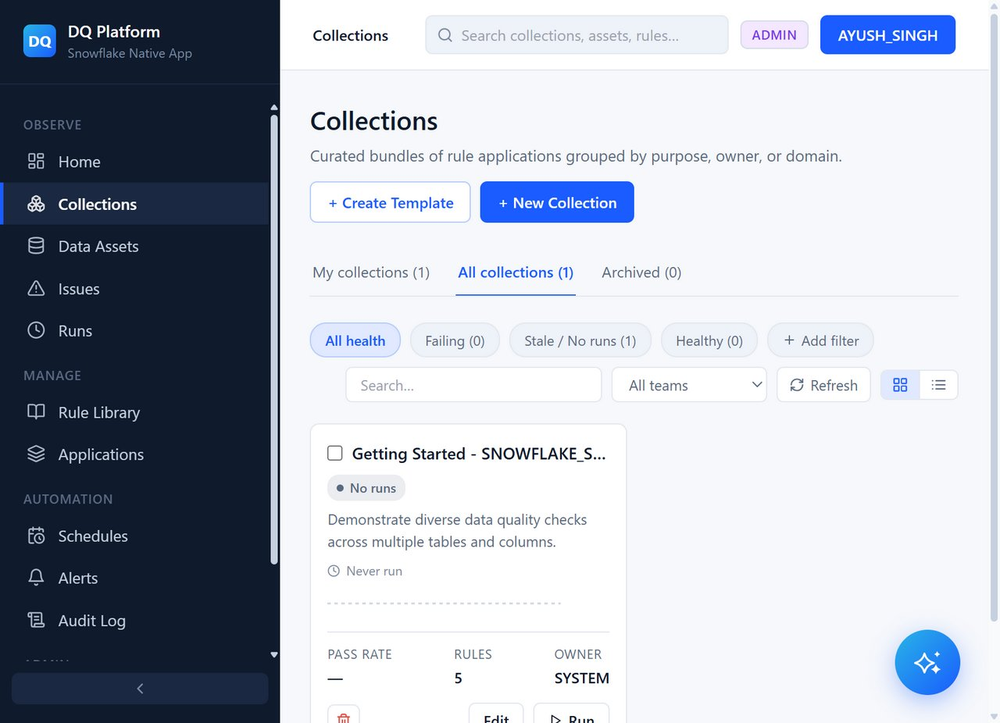

# Step 5: Executing Runs, Inspecting Issues & Ask DQ Assistant

This final tutorial step covers running your quality checks, inspecting results and triage issues, and leveraging the built-in Cortex AI Assistant.

---

## 1. Triggering an Execution Run

1. Navigate to **Collections** in the sidebar.
2. Select your collection (e.g. **Getting Started - SNOWFLAKE_SAMPLE_DATA**).
3. Click **Run now** in the top action bar.



4. The execution engine evaluates all active rule applications against your target tables using Snowflake compute.

---

## 2. Viewing Results & Issues

1. In the sidebar under **Observe**, click **Runs** to view execution logs, run durations, total checks evaluated, pass rates, and failure breakdowns.
2. Click **Issues** to see any records violating your defined rules:
   - Identifies failed rule name and severity.
   - Shows target table and column (e.g. `CUSTOMER.C_ACCTBAL`).
   - Displays failed row count and sample offending records.
   - Allows assigning issues to team members (e.g., `DataGovernance`) or setting status (`OPEN`, `INVESTIGATING`, `RESOLVED`).

---

## 3. Interacting with "Ask the DQ Assistant"

Artha DataTrust includes a built-in AI assistant backed by Snowflake Cortex AI that answers natural language questions and can plan and create data quality collections automatically.

### A. Conversational Insights (Cortex Analyst)
Ask natural language questions about your data quality posture:
- *"Which tables have had the most failures this week?"*
- *"Show me all rules related to completeness or validity that are failing."*
- *"What is the data quality trend for the Customer schema?"*
- *"Which collections have the lowest pass rate?"*

The assistant queries historical execution results, rule metadata, and active issues to provide conversational answers with actionable context.

### B. Action Planning & Collection Generation (Cortex AI)
You can also ask the assistant to take action and generate new collections on your granted tables:
- *"Create a new data quality collection called 'Data Assets Health Check' for monitoring my tables. Apply 2 different rules testing completeness and uniqueness."*

The assistant will formulate an **Action Plan Confirmation Card** showing proposed tables, rules, alert channels, and schedule. Once you click **Confirm**, the collection and rule applications are created and ready to run.

---

## 4. Licensing & Trial Tiers

When first installed from the Marketplace, the app operates under the **Trial Plan** until the listing purchase is completed:
- **Trial Quotas**:
  - `Collections`: 1 active collection
  - `Starter Collections`: 1 auto-generated starter collection
  - `Alert Channels`: 1 active alert channel
  - `Rule Applications`: Up to 5 active rule applications
- To check your account's licensing status and limits at any time, run:
  ```sql
  SELECT * FROM ARTHA_DATATRUST.DQ_CORE.LICENSE_STATUS;
  ```
- Upgrading to the Paid Marketplace Listing automatically removes all trial limits via `SYSTEM$IS_LISTING_PURCHASED()`.

---

## Conclusion & Summary

You have completed the full end-to-end journey of **Artha DataTrust**:
1. Installed the application and granted table permissions via the Snowsight Permissions UI.
2. Verified data asset discovery in the catalog.
3. Created user roles and organized teams for governance.
4. Bound pre-built system rules to target tables and columns.
5. Executed data quality runs, reviewed issues, and queried the Cortex AI Assistant.
